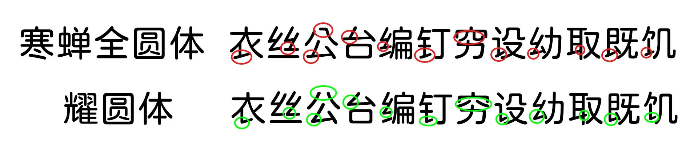

# 耀圆体 KirakaraMaru

本字体以 [寒蝉全圆体](https://github.com/Warren2060/ChillRound) 为目标字体，挑选原字体中符合大陆规范的字，人工调整一些字后使用 [zi2zi-JiT](https://github.com/kaonashi-tyc/zi2zi-JiT) 训练其风格，以 [思源黑体CN](https://github.com/adobe-fonts/source-han-sans)、[文渊黑体、文渊宋体](https://github.com/takushun-wu/WenYuanFonts)、[Jigmo](https://kamichikoichi.github.io/jigmo/)、[遍黑体](https://github.com/Fitzgerald-Porthmouth-Koenigsegg/Plangothic_Project) 为结构参考字体，重新生成剩余字。

[遍黑体](https://github.com/Fitzgerald-Porthmouth-Koenigsegg/Plangothic_Project) 作者于2026年9月26日更新了 README:
> 近来发现，本字体遭到第三方使用AI（人工智能）技术训练后用于再生成字体，由于实际训练数据不明，生成的字体具有一定的法律风险。因此，如您遇到某些声称基于本字体或上游字体训练而成的AI字体，请不要使用！

虽然没什么说服力，但是本字体训练及生成用的所有字体已经在上方列出，上游协议为 OFL 与 CC0 1.0（与 OFL 兼容）。对于 AI 造字，[落霞孤鹜](https://github.com/lxgw)大佬根据 [OFL 官网](https://openfontlicense.org/ofl-faq/) 给出了解释：https://github.com/feiyangjun-1/Sumr-Sans/issues/1 。
所以无需担心本字体协议与授权问题。但本字体也只是缓兵之计，希望有后来者可以做出此字体的完美替代品。

目前已覆盖绝大部分 GB2312、现代汉语常用字表、现代汉语通用字表、义务教育语文课程常用字表、通用规范汉字表、[落霞孤鹜 外字初步整理表（第一部分）](https://github.com/lxgw/ext-characters/blob/main/tables/ext_characters_table_1.md)、[绵饴字集](https://www.maoken.com/eyes/business/27905.html) 和 [NAF194](https://github.com/Hansha2011/NAF/blob/main/NAF194.md)。

注意事项：
1. 程序生成出来的是 256 像素的 png 图片，矢量化后字体会有边缘不够平滑、点数太多的问题。
2. 其中一些复杂的不常用字由于程序一直生成不出来，没有被收录。
3. 程序生成的字体会有不协调的问题。
4. 虽然已经人工检查，但可能还是会有部分字有错误。
5. “亠”仍然是竖横；衤礻上面是竖，不是点；“之”不是大陆规范。这些如果要改掉的话训练用字就就几乎没了，所以没改。以后有可能会改。
6. 如有发现问题请在 [Issues](https://github.com/feiyangjun-1/KirakaraMaru/issues) 提出。

下个版本修复：
1. `亠`仍然是竖横；`衤礻`上面是竖，不是点；`之`不是大陆规范。
2. `肏`上面是`人`
3. `顾`非国标
4. 逐个检查所有字，把有问题的字重新生成
5. 把数字替换成小杉

本字体使用 OFL 协议，可免费商用、随意修改等。
