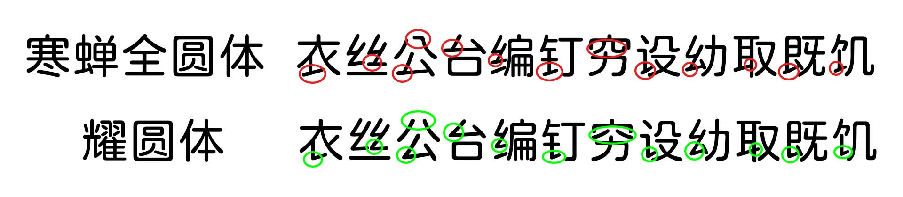

# 耀圆体 KirakaraMaru

本字体以 [寒蝉全圆体](https://github.com/Warren2060/ChillRound) 为目标字体，人工挑选原字体中符合大陆规范的字后使用 [zi2zi-JiT](https://github.com/kaonashi-tyc/zi2zi-JiT) 训练其风格，以 [文渊宋体](https://github.com/takushun-wu/WenYuanFonts) 和 [字形维基中的单字svg](zhs.glyphwiki.org) 为结构参考字体，重新生成剩余字。

> 1.2及以前的版本使用过的参考字体还包含 [思源黑体CN](https://github.com/adobe-fonts/source-han-sans)、[Jigmo](https://kamichikoichi.github.io/jigmo/) 和 [遍黑体](https://github.com/Fitzgerald-Porthmouth-Koenigsegg/Plangothic_Project)。之后的版本不再使用这些字体，也不包含以其作为参考而生成的字型。

对于 AI 造字，[落霞孤鹜](https://github.com/lxgw) 大佬根据 [OFL 官网](https://openfontlicense.org/ofl-faq/) 给出了解释：https://github.com/feiyangjun-1/Sumr-Sans/issues/1 。所以无需担心本字体协议与授权问题。但本字体也只是缓兵之计，希望有后来者可以做出此字体的完美替代品。

目前已覆盖绝大部分 GB2312、现代汉语常用字表、现代汉语通用字表、义务教育语文课程常用字表、通用规范汉字表、[落霞孤鹜 外字初步整理表（第一部分）](https://github.com/lxgw/ext-characters/blob/main/tables/ext_characters_table_1.md)、[绵饴字集](https://www.maoken.com/eyes/business/27905.html) 和 [NAF194](https://github.com/Hansha2011/NAF/blob/main/NAF194.md)。

注意事项：
1. 程序生成出来的是 256 像素的 png 图片，矢量化后字体会有边缘不够平滑、点数太多的问题。
2. 其中一些复杂的不常用字由于程序一直生成不出来，没有被收录。
3. 程序生成的字体会有不协调的问题。
4. 虽然已经人工检查，但可能还是会有部分字有错误。
5. “亠”仍然是竖横；衤礻上面是竖，不是点；“之”不是大陆规范。这些如果要改掉的话训练用字就就几乎没了，所以没改。以后有可能会改。
6. [Issue#1](https://github.com/feiyangjun-1/KirakaraMaru/issues/1)
7. 如有发现问题请在 [Issues](https://github.com/feiyangjun-1/KirakaraMaru/issues) 提出。

下个版本修复：
1. 逐个检查所有字，重新训练、重新生成所有不合规范的字，同时也会修复注意事项中的5、6
2. 不再使用遍黑体、Jigmo、思源黑体作为结构参考字体
3. 把数字替换成小杉圆体
4. 尝试解决字体点数过多的问题

本字体使用 OFL 协议，可免费商用、随意修改等。
